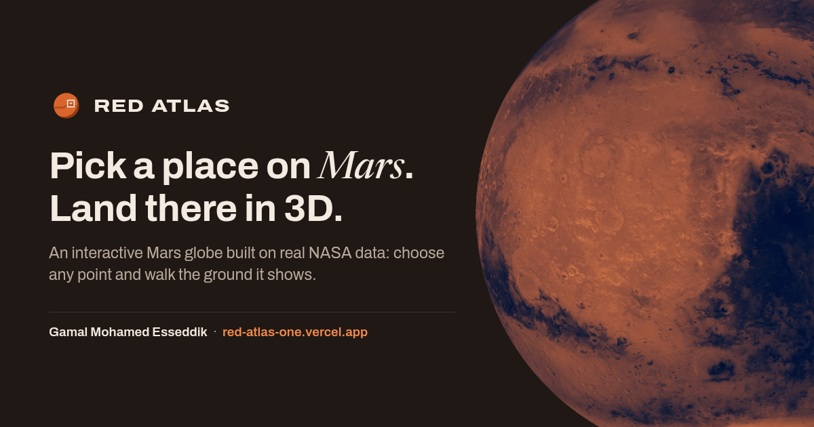
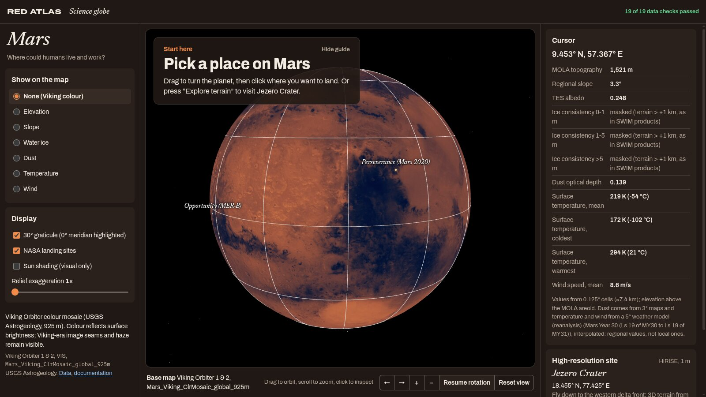
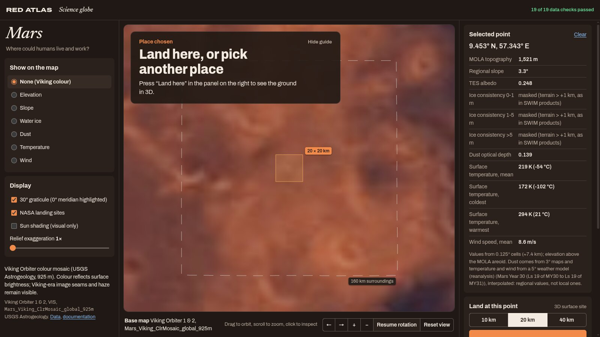
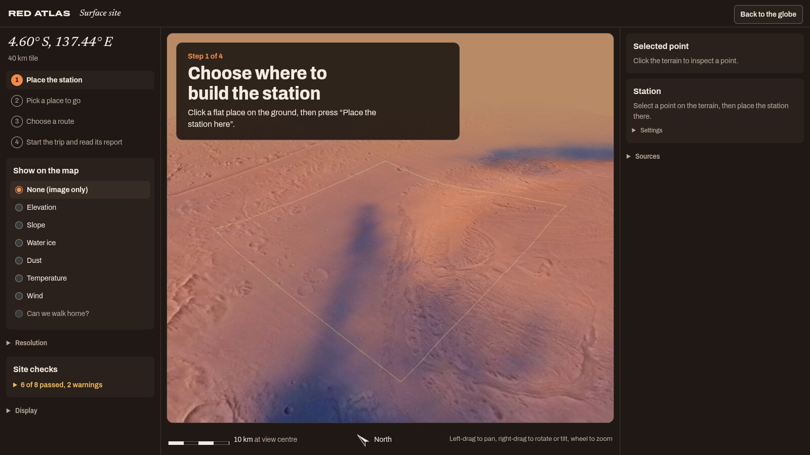

<p align="center">
  
</p>

<h1 align="center">RED ATLAS</h1>

<p align="center">
  <b>An interactive 3D map of Mars, built on real NASA, USGS and ESA data.</b><br>
  Pick any place on the planet, land there, and plan a crew's work on the ground.
</p>

<p align="center">
  <a href="https://red-atlas-one.vercel.app"><b>Open the live site</b></a> ·
  <a href="docs/DATA_SOURCES.md">Data sources</a> ·
  <a href="#run-it-on-your-computer">Run it locally</a>
</p>

---

RED ATLAS was made for the NASA Space Apps challenge **“Interplanetary Survival Guide: Martian Map”**: where on Mars
could humans live and work? It answers with a science globe you can read point by point, and a 3D surface view of any
site you choose.

**Project lead:** Gamal Mohamed Esseddik

## What you can do

### 1. Read the planet


- **Base map:** the Viking Orbiter colour mosaic on a globe shaped by MOLA laser altimetry.
- **Layers:** elevation, slope, water ice at three depths (SWIM project), dust, surface temperature and wind.
- **Readout:** hover or click anywhere for latitude, longitude and every layer's value at that point.
- **Context:** NASA landing sites, the Perseverance traverse, the Jezero HiRISE tile and a 30° grid.

### 2. Choose a site and see its true size


Click a point and pick **10, 20 or 40 km**. The globe zooms in and draws the high-resolution square at its real size,
inside the fixed 160 km area of lower-resolution surroundings that comes with every site.

### 3. Land there in 3D


**Land here** builds the site on demand, usually in 15 to 20 seconds online:
- **Elevation:** the HRSC–MOLA blended DEM at 200 m.
- **Imagery:** the CTX global mosaic at about 5 m, coloured from the Viking mosaic.
- **Checks:** each site is validated against MOLA, and the results are shown in the app.

**Explore terrain** opens the 1 m HiRISE model of Jezero Crater, where Perseverance landed.

### 4. Plan the crew's work
In the 3D view, the app walks through four steps:
1. **Place the station** on flat ground.
2. **Pick a place** to go.
3. **Choose a route.** Routes are computed from slope, dust, wind exposure and ground temperature.
4. **Run the trip** and read its report.

During the trip the crew's body is simulated from published physiology: energy use, heart rate, suit oxygen, dust
and radiation dose. Each report changes how the next trip is planned. Every assumption is labelled as one in the app.

## How the data is kept honest
- Every product's live header is checked against the values transcribed in `pipeline/config.yaml`. The build stops on
  any mismatch.
- Elevation and imagery are reprojected onto one local grid (Mars 2000 sphere, R = 3,396,190 m), so they line up by
  construction and 1 scene unit is 1 m on the ground.
- Clicked elevations come from the real elevation grid, not from the 3D mesh.
- The header badge shows how many automated data checks passed. All sources, licences, conventions and checks are in
  [`docs/DATA_SOURCES.md`](docs/DATA_SOURCES.md).

## Run it on your computer
You need **Node.js 22+** and **Python 3.12+** on your PATH. Then, in this folder:

```bash
npm start
```

This one command does the whole setup the first time, and just starts the app after that:
- creates a project-local Python environment and installs the pinned packages and web dependencies;
- builds any missing globe and climate data and runs the accuracy audit;
- starts the viewer and the local “Land here” builder, then opens your browser.

The first setup downloads about **1.4 GB** of source data, so allow **5 GB** of free disk space. Keep the terminal
open while you use the app; Ctrl+C stops it.

For development, run `npm run dev` in `web/`. Checks: `node check-globe.mjs` and `node check-geo.mjs` in `web/`,
and `npm run build` for the type check and production build.

## How it is built
| Part | Technology |
|---|---|
| Viewer | React, Three.js (React Three Fiber), Vite, TypeScript |
| Data pipeline | Python: rasterio, NumPy, Pillow, PyYAML |
| Online hosting | Vercel: static site, a Python function that builds “Land here” sites, Vercel Blob to store them |

```
web/        the viewer (globe, 3D surface view, crew simulation)
pipeline/   data builders: build_terrain.py, build_globe.py, build_climate.py, audit.py,
            site_server.py (local builder), online_builder.py (Vercel builder)
api/        Vercel entry point for the online builder
docs/       DATA_SOURCES.md: every source, licence and check
```

## Data credits
NASA, JPL-Caltech and the University of Arizona (HiRISE); NASA/JPL/MSSS/The Murray Lab (CTX); NASA GSFC (MOLA);
ESA, DLR and FU Berlin (HRSC); USGS Astrogeology (Viking mosaic, blended DEM, HiRISE DTM); SWIM4MIM, PSI and NASA JPL
(subsurface water ice); Montabone et al. 2015 (dust); OpenMARS, Open University (temperature and wind). Full
citations and licences are in [`docs/DATA_SOURCES.md`](docs/DATA_SOURCES.md).

## Author
**Gamal Mohamed Esseddik**, project lead.
